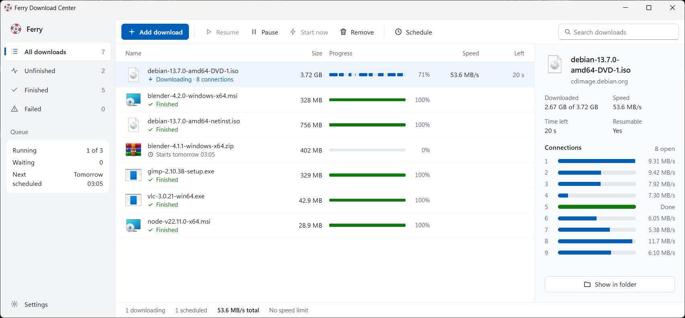
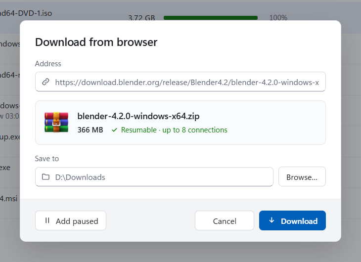
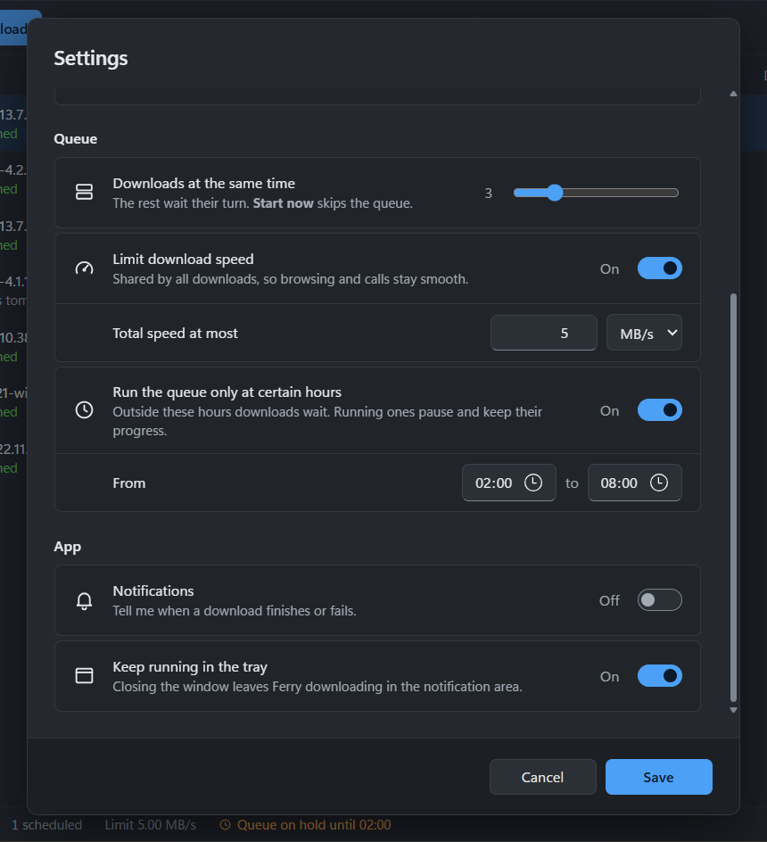
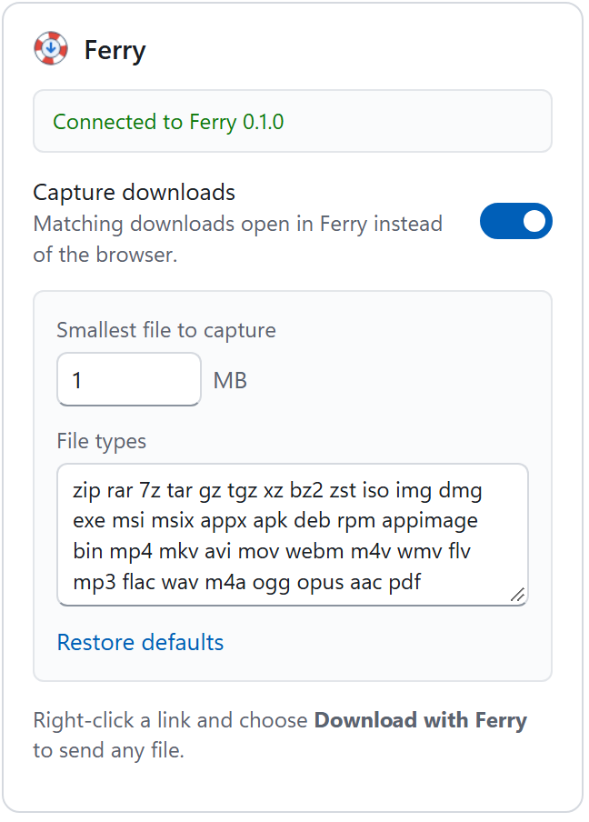

<div align="center">


# Ferry Download Center

**A fast, free download manager for Windows.**

Splits every download into parts that come in side by side, pauses and resumes, even after a restart,
and runs a queue on your schedule. A browser extension hands your downloads over from Chrome.

[](https://github.com/yushadev0/ferry/releases/latest)
[](https://github.com/yushadev0/ferry/actions/workflows/ci.yml)
[](#license)




</div>

## Install

1. Download **`Ferry.Download.Center_x.y.z_x64-setup.exe`** from the [latest release](https://github.com/yushadev0/ferry/releases/latest).
2. Run it. It installs for your user only, without admin rights. Windows SmartScreen may warn that the publisher is unknown, because the installer isn't code-signed yet: choose **More info › Run anyway**.
3. Add the browser extension from the [Chrome Web Store](https://chromewebstore.google.com/detail/ofkibiokjdlboldiiplkllehifkjbihd). After installing, Ferry also offers it the next time you open Chrome.

Ferry keeps itself up to date: it checks GitHub for new versions and tells you, and you install with one click in **Settings › Updates**. Downloads that were running carry on after the restart. Nothing installs without you.

## What it does

<table>
  <tr>
    <td width="50%"></td>
    <td width="50%"></td>
  </tr>
  <tr>
    <td><b>🌐 From your browser.</b> Downloads you start in Chrome open in Ferry instead, with the page's sign-in, so files from sites you're logged in to still work. You choose the file types and a minimum size; anything else stays in the browser. Right-click a link for <b>Download with Ferry</b>.</td>
    <td><b>🗓️ A queue on your terms.</b> A few downloads at a time, the rest wait their turn. Run the queue only at night, cap the total speed so calls stay smooth, or start one download at a set time.</td>
  </tr>
</table>

**⚡ Split into parts.** Each file is downloaded over up to 16 connections at once (8 by default). When a part finishes early, Ferry splits the biggest remaining one, so all connections keep working until the end. Servers that allow fewer connections or limit how often you ask are detected and respected.

**⏯️ Pause and resume.** Pause any download and pick it up later, also after closing Ferry, restarting Windows or losing the connection. If the file changed on the server in the meantime, Ferry notices and starts over instead of stitching two versions together.

**🧭 See what's happening.** The progress bar shows every part, and the details pane shows each connection's speed. Downloads are grouped into unfinished, finished and failed, and searchable.

**🪟 At home on Windows 11.** Light or dark, in English or Turkish, following Windows or your choice. Windows' own file icons, notifications when downloads finish, and a tray icon so Ferry can keep working with the window closed.

## The browser extension



The extension is for Chrome (Edge is on the way). Its popup shows whether Ferry is running, turns capture on or off and edits the file types and the minimum size.

- Downloads in incognito windows, and `blob:` or `data:` links, always stay in the browser.
- If Ferry isn't running, the extension starts it. If Ferry isn't installed, the browser downloads the file as usual.
- The extension talks only to Ferry on your own computer, through Chrome's native messaging. Nothing is sent anywhere else. See the [privacy policy](docs/privacy.md).

<br clear="right" />

## Build from source

Requirements: Windows 10/11, [Rust](https://rustup.rs) (MSVC toolchain), [Node.js](https://nodejs.org) 20+ and [pnpm](https://pnpm.io).

```powershell
cd app
pnpm install
pnpm tauri dev      # run in development
pnpm tauri build    # build the installer into target/release/bundle/nsis (see below)
cargo test --workspace
```

To try the extension from source, open `chrome://extensions`, turn on Developer mode, choose **Load unpacked** and pick the `extension` folder ([details](extension/README.md)).

| Path | What it is |
| --- | --- |
| [`crates/ferry-core`](crates/ferry-core) | The download engine: parts, resume, queue, speed limit. A library with no UI. |
| [`crates/ferry-host`](crates/ferry-host) | The small program Chrome starts to pass downloads to Ferry. |
| [`app`](app) | The desktop app: [Tauri 2](https://tauri.app) (Rust) with a Svelte + TypeScript UI. |
| [`extension`](extension) | The browser extension (Manifest V3). |

Installers are signed for the updater, so `pnpm tauri build` needs the private key in `TAURI_SIGNING_PRIVATE_KEY` (the release workflow takes it from the repository secret of the same name). Releases are built by GitHub Actions: bump the version in `Cargo.toml`, `app/src-tauri/tauri.conf.json` and `app/package.json`, then push a `vX.Y.Z` tag. The extension has its own version in `extension/manifest.json` and ships through the Chrome Web Store.

## Türkçe

Ferry, Windows için hızlı ve ücretsiz bir indirme yöneticisi. Her dosyayı parçalara bölüp aynı anda birkaç bağlantıyla indiriyor; biten parçaların yerine kalanları yeniden bölüyor, böylece indirme sonuna kadar hızlı kalıyor. İndirmeleri istediğin an duraklatıp sonra devam ettirebilirsin; Ferry'yi kapatsan, bilgisayarı yeniden başlatsan ya da bağlantı kopsa bile. Kuyruk aynı anda birkaç indirmeyi çalıştırıyor, istersen yalnızca gece saatlerinde ve bir hız sınırının altında. Chrome eklentisi, tarayıcıda başlattığın indirmeleri oturum bilgisiyle birlikte Ferry'ye gönderiyor; gizli pencerelere hiç dokunmuyor.

Kurmak için [son sürümden](https://github.com/yushadev0/ferry/releases/latest) `Ferry.Download.Center_x.y.z_x64-setup.exe` dosyasını indirip çalıştır. SmartScreen uyarırsa **Ek bilgi › Yine de çalıştır**'ı seç. Ardından eklentiyi [Chrome Web Store](https://chromewebstore.google.com/detail/ofkibiokjdlboldiiplkllehifkjbihd)'dan ekle. Arayüz Türkçe ve İngilizce; Windows'un diline göre açılır, Ayarlar'dan değiştirebilirsin. Ferry yeni sürümleri kendisi bulur ve haber verir; **Ayarlar › Güncellemeler**'den tek tıkla kurarsın.

## License

Licensed under either of [Apache License, Version 2.0](LICENSE-APACHE) or [MIT license](LICENSE-MIT), at your option. Unless you explicitly state otherwise, any contribution intentionally submitted for inclusion in this project by you, as defined in the Apache-2.0 license, shall be dual licensed as above, without any additional terms or conditions.

The screenshots show real downloads of publicly available files (Debian, Blender, GIMP, VLC and Node.js) made for the demo.
